<div align="center">

# iMuseum

**Convierte cualquier carpeta de fotos, videos y música en un museo 3D que se recorre a pie.**

*Turn any folder of photos, videos and music into a walkable 3D museum.*

[](https://github.com/beiacox/imuseum/releases/latest/download/iMuseum-0.2.0.AppImage)
[](https://github.com/beiacox/imuseum/releases/latest/download/imuseum_0.2.0_amd64.deb)


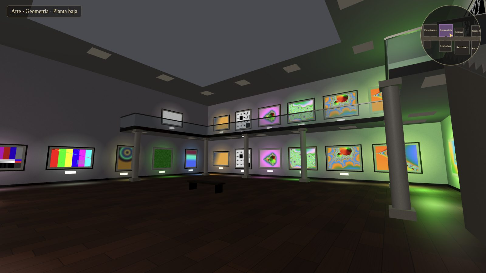

</div>

Eliges una carpeta y iMuseum recorre todas sus subcarpetas: cada carpeta se convierte en
una sala, las **imágenes** se cuelgan como cuadros, los **videos** se proyectan en pantallas
y los **audios** suenan en gramófonos. El museo está a oscuras y **cada obra ilumina la sala
con su propio color**.

Está pensado para colecciones enormes (cientos de GB): los archivos se leen **directamente
del disco**, nunca se copian ni se suben a internet, y solo existe en memoria la parte del
museo que tienes cerca.

## Contenido

- [Capturas](#capturas)
- [Características](#características)
- [Instalación](#instalación)
- [Uso y controles](#uso-y-controles)
- [Ajustes](#ajustes)
- [Rendimiento con colecciones grandes](#rendimiento-con-colecciones-grandes)
- [Desarrollo](#desarrollo)
- [Estructura del código](#estructura-del-código)
- [Hoja de ruta](#hoja-de-ruta)
- [Licencia](#licencia)

## Capturas

Todas las capturas son de la app de escritorio real (se generan con `scripts/screenshots.mjs`).

| | |
|---|---|
| 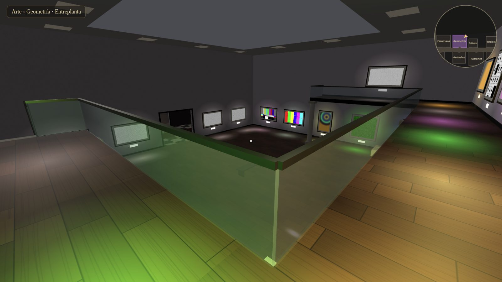 **Entreplanta** — balcón en U con barandillas de vidrio y obras en los dos niveles. | 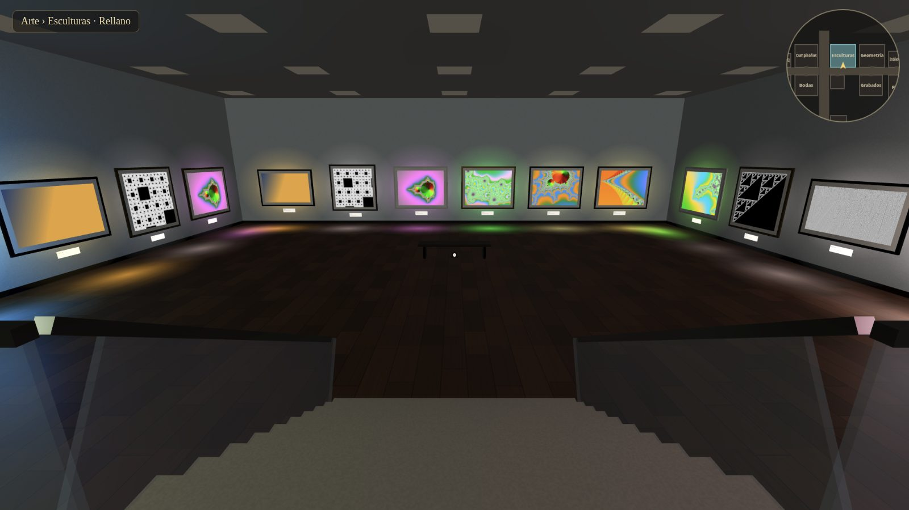 **Sala hundida** — rellano a la altura del pasillo y escalera hasta un foso de 1,6 m. |
| 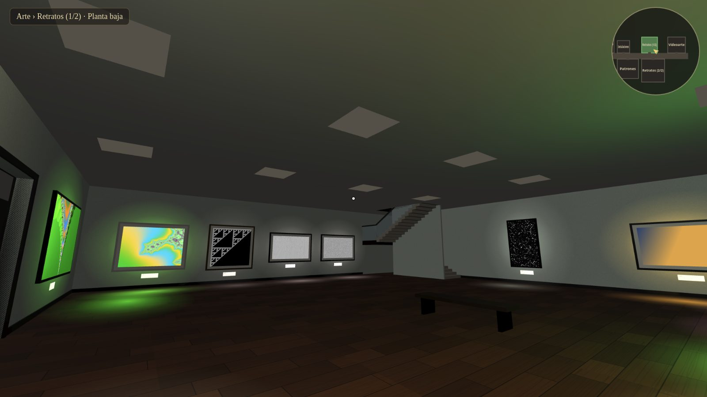 **Torre de varios pisos** — escalera de ida y vuelta con descansillos. | 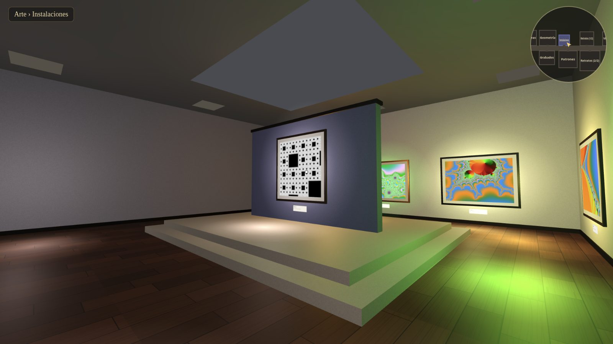 **Sala de paneles** — tarima central con paneles exentos de doble cara. |
| 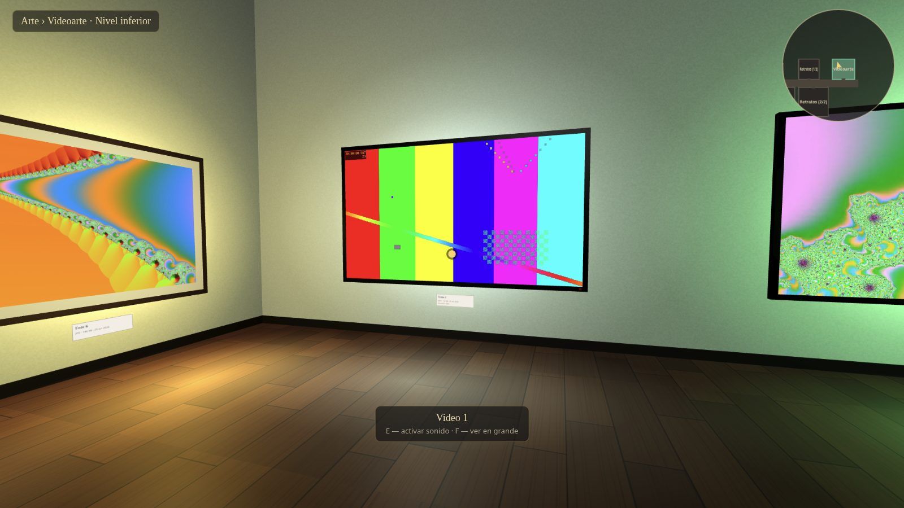 **Videos** — la luz de cada pantalla sigue al fotograma que muestra. | 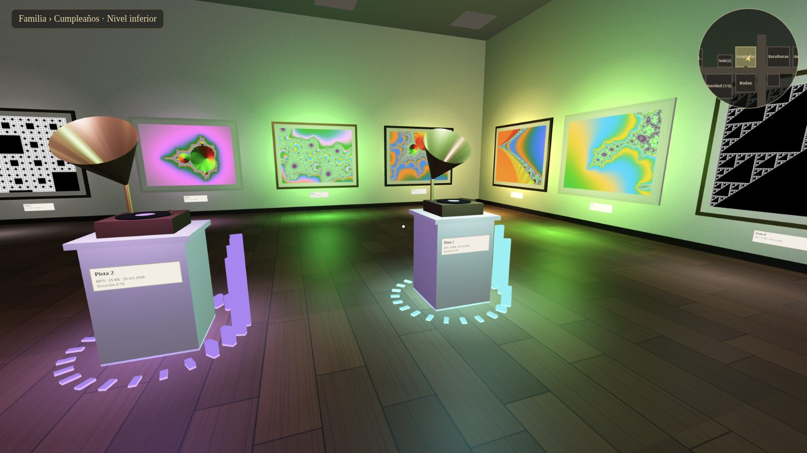 **Gramófonos** — sonido 3D, vinilo girando y luz que late con la música. |
| 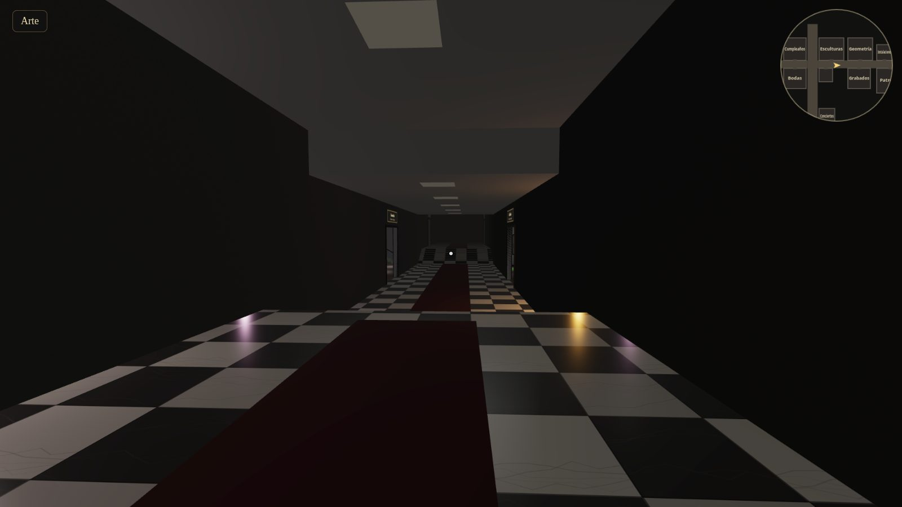 **Pasillos con desniveles** — a oscuras, con carteles retroiluminados. | 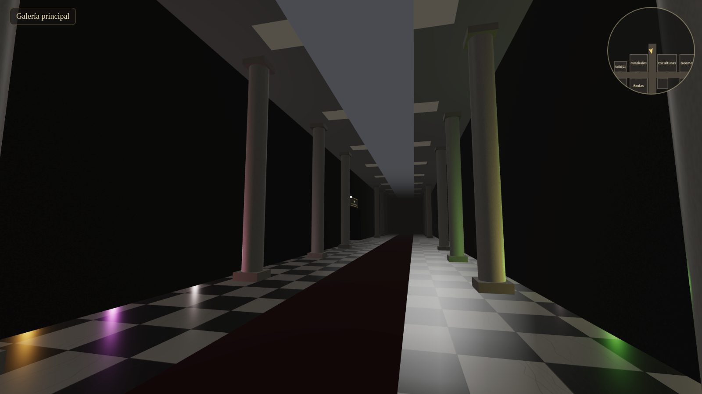 **Galería principal** — columnata y lucernario; de ella salen las alas. |
| 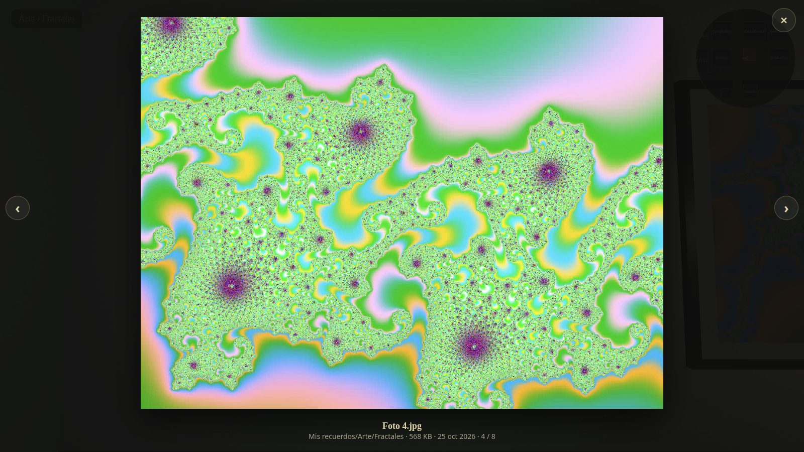 **Visor** — cualquier obra a pantalla completa, con ← → para recorrer la sala. | 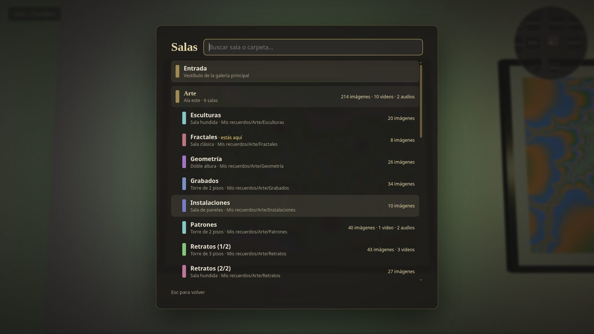 **Directorio (Tab)** — búsqueda y teletransporte a cualquier ala o sala. |
| 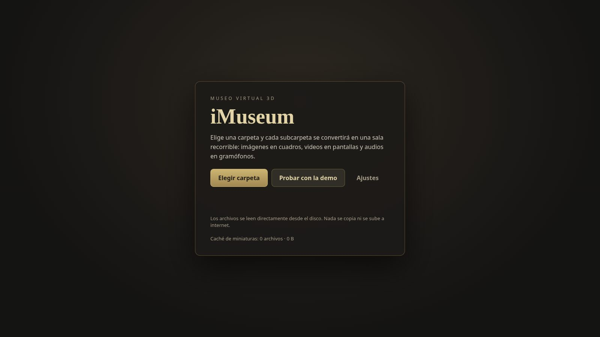 **Inicio** — elegir carpeta, carpetas recientes y caché de miniaturas. | 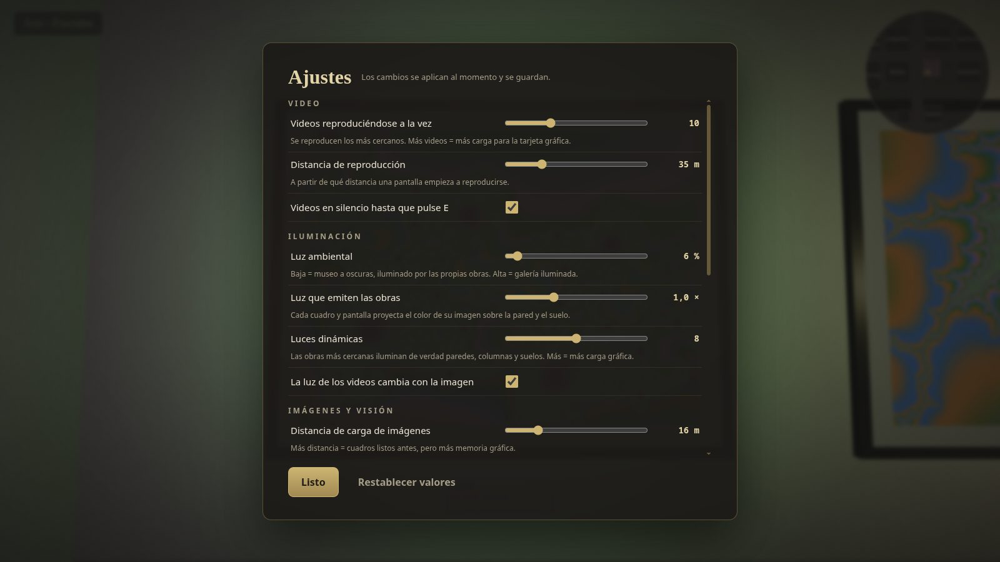 **Ajustes** — rendimiento, iluminación y controles, guardados al momento. |

## Características

### Del archivo a la obra

| Archivo | En el museo |
|---|---|
| Imágenes — jpg, png, gif, webp, avif, bmp, svg, ico | Cuadro enmarcado con passe-partout y cartela (nombre, tipo, tamaño, fecha) |
| Videos — mp4, m4v, webm, mov, ogv, mkv¹ | Pantalla que se reproduce sola (en silencio) al acercarte; **E** activa el sonido 3D, **F** la abre en grande |
| Audios — mp3, wav, ogg, m4a, aac, flac, opus | Gramófono sobre pedestal con sonido posicional, disco girando y visualizador |

¹ Según los códecs de Chromium: HEVC/H.265 y algunos mkv pueden no reproducirse; se muestra
«Formato no compatible» en la pantalla.

### Arquitectura variada

El museo no es plano. Cada sala elige un tipo según cuánto contiene (con variedad entre
salas parecidas):

| Tipo | Cómo es | Cuándo aparece |
|---|---|---|
| Sala clásica | Rectangular, banco central | Carpetas pequeñas |
| Sala hundida | Rellano, escalera con barandillas y foso 1,6 m más bajo con paredes de 6 m | Pequeñas y medianas |
| Sala de paneles | Sala alta con tarima y paneles exentos de doble cara, lucernario | Sin audios, pequeñas y medianas |
| Doble altura | Balcón en U a 4,4 m, columnas, escalera de obra, obras en ambos niveles | Medianas |
| Torre de 2 o 3 pisos | Pisos de 4,6 m unidos por escalera de ida y vuelta | Grandes |

Las salas se organizan en una **galería principal** (7 m de alto, columnata y lucernario) de la
que salen **alas** —una por carpeta de primer nivel— cuyos pasillos suben y bajan con
escaleras de ancho completo. Se camina con física real: suelos, rampas, escaleras, gravedad y
colisiones que tienen en cuenta la altura.

### Las obras son la luz

- Cada cuadro proyecta el **color medio de su imagen** sobre la pared y el suelo.
- Cada pantalla proyecta el color del **fotograma actual** (muestreado ~8 veces por segundo).
- Los gramófonos iluminan con el color de su disco y **laten con la música**.
- Las obras más cercanas reciben además una **luz dinámica real** que ilumina paredes,
  columnas, barandillas y suelos.

## Instalación

### Linux (probado)

Descarga desde la [última versión](https://github.com/beiacox/imuseum/releases/latest):

- **AppImage** (cualquier distribución, sin instalar):
  ```bash
  chmod +x iMuseum-0.2.0.AppImage
  ```
  ```bash
  ./iMuseum-0.2.0.AppImage
  ```
- **.deb** (Debian, Ubuntu, Mint…):
  ```bash
  sudo apt install ./imuseum_0.2.0_amd64.deb
  ```

### Windows y macOS

La configuración de empaquetado está lista (`npm run dist:win`, `npm run dist:mac`), pero
**todavía no se han compilado ni probado** en esos sistemas. Conviene generarlos en el propio
sistema (ver [Desarrollo](#desarrollo)).

### Versión web

También funciona en el navegador sin instalar nada (`npm run dev`). En Chrome/Edge se usa el
selector de carpetas nativo del navegador; en Firefox/Safari, la subida de carpetas. Para
colecciones grandes, usa la app de escritorio.

## Uso y controles

1. **Elegir carpeta** (o una de las **carpetas recientes**). La app escanea solo nombres,
   tamaños y fechas, y construye el museo.
2. Haz clic para entrar y camina.

| Tecla | Acción |
|---|---|
| **W A S D** / flechas + ratón | Caminar y mirar (**Shift** para correr) |
| **E** o clic | Ampliar imagen · activar/silenciar video · reproducir/pausar audio |
| **F** | Ver el video en grande, con controles |
| **← →** (en el visor) | Obra anterior / siguiente de la sala |
| **Tab** | Directorio de alas y salas, con búsqueda y teletransporte |
| **M** | Mostrar / ocultar minimapa |
| **F11** | Pantalla completa |
| **Esc** | Pausa |

El indicador superior muestra dónde estás, incluido el piso: «Planta baja», «Entreplanta»,
«Piso 2», «Nivel inferior»…

**Historial**: en la pantalla de inicio, **✕** quita una carpeta de la lista y **Borrar
historial** (dos clics) la vacía. Ninguna de las dos acciones borra nada del disco.

## Ajustes

Botón **Ajustes** en la pantalla de inicio y en la pausa. Los cambios se aplican al momento y
se guardan en la carpeta de datos de la app.

| Sección | Ajuste | Por defecto | Rango |
|---|---|---|---|
| Video | Videos reproduciéndose a la vez | 10 | 1–30 |
| | Distancia de reproducción | 35 m | 8–120 m |
| | Videos en silencio hasta pulsar E | sí | sí / no (sonido posicional automático) |
| Iluminación | Luz ambiental | 6 % | 0 % (a oscuras) – 100 % (galería iluminada) |
| | Luz que emiten las obras | 1× | 0–3× |
| | Luces dinámicas | 8 | 0–16 |
| | La luz de los videos cambia con la imagen | sí | sí / no |
| Imágenes y visión | Distancia de carga de imágenes | 16 m | 8–45 m |
| | Resolución de los cuadros | 1024 px | 512 / 1024 / 2048 px |
| | Distancia de visión (niebla) | 60 m | 40–150 m |
| | Calidad de imagen | Alta | Muy baja – Máxima |
| Controles | Sensibilidad del ratón · velocidad · campo de visión | 1× · 3,6 m/s · 70° | |
| Sonido e interfaz | Volumen · minimapa · contador de FPS | 80 % · sí · no | |

El **contador de FPS** muestra también cuántos videos se reproducen y cuántas salas hay en
memoria: úsalo para encontrar el punto justo para tu tarjeta gráfica. Si va lento, baja
primero **Luces dinámicas** y **Videos reproduciéndose a la vez**.

## Rendimiento con colecciones grandes

| Qué | Cómo | Medido |
|---|---|---|
| Escaneo | Node recorre el árbol leyendo solo nombres, tamaños y fechas; se puede cancelar | 415.000 archivos / 31.000 carpetas en ~6 s (SSD) |
| Multimedia | Protocolo propio `imuseum://` con peticiones por rangos: un video de 4 GB se lee a trozos | — |
| Fotos | Se decodifican fuera del hilo principal y se guardan como miniaturas WebP en caché | 2.ª visita a una sala: ~270 ms |
| Museo | Todo el museo es solo datos; las salas se construyen al acercarte y se destruyen al alejarte | 76.000 archivos → 2.125 salas en 144 alas en ~0,2 s, ~110 MB de memoria |

La caché de miniaturas vive en la carpeta de datos de la app (`~/.config/iMuseum/thumbs` en
Linux). La pantalla de inicio muestra cuánto ocupa y permite vaciarla.

Más detalles técnicos en [docs/ARQUITECTURA.md](docs/ARQUITECTURA.md).

## Desarrollo

Requisitos: **Node.js 20+** y, para generar la demo, **ffmpeg**.

```bash
npm install
```
```bash
npm run demo        # genera public/demo (multimedia de ejemplo) con ffmpeg
```
```bash
npm run app         # app de escritorio con recarga en caliente (Vite + Electron)
```

| Script | Qué hace |
|---|---|
| `npm run app` | App de escritorio en modo desarrollo |
| `npm run app:prod` | App de escritorio con el build de producción |
| `npm run dev` | Versión web en http://localhost:5173 |
| `npm run demo` | Regenera la multimedia de ejemplo de `public/demo` |
| `npm run dist:linux` | Build + AppImage y .deb en `release/` |
| `npm run dist:win` / `dist:mac` | Instaladores para Windows / macOS (sin probar) |
| `npm run test:e2e` | Prueba de extremo a extremo con la app real |
| `npm run screenshots` | Regenera las capturas de `docs/screenshots` |

### Pruebas

`scripts/selftest.mjs` abre la app de escritorio, la controla por el protocolo de DevTools y
comprueba: escaneo de una carpeta del disco, streaming por rangos (respuesta 206), que todas
las salas cargan sus obras, la caché de miniaturas, que los ajustes persisten tras reiniciar y
la gestión del historial.

```bash
npm run test:e2e
```
```bash
IMUSEUM_BIN=release/linux-unpacked/imuseum node scripts/selftest.mjs
```

La segunda forma prueba el binario empaquetado. Ambas abren una ventana durante ~1 minuto.

## Estructura del código

```
electron/
  main.cjs         ventana, protocolo imuseum:// (app, multimedia, miniaturas), IPC, historial
  preload.cjs      puente seguro (contextIsolation) → window.imuseumNative
  scan.cjs         escaneo recursivo sin leer contenido
shared/
  media-types.json extensiones reconocidas (Node y navegador)
src/
  main.js          escena, UI (inicio, pausa, ajustes, directorio, visor), interacción
  scanner.js       escaneo (escritorio o navegador) → obras; agrupación en salas
  layout.js        tipo de cada sala, reparto de obras, alas con desniveles
  architecture.js  tipos de sala, pasillos y galería como datos
  meshbuilder.js   fusiona la geometría de cada sala en una malla por material
  museum.js        construcción por cercanía, colisiones y suelos, carga de texturas
  exhibits.js      cuadro, pantalla de video, gramófono
  lighting.js      luces dinámicas asignadas a las obras más relevantes
  player.js        primera persona: suelo, escaleras, gravedad, colisiones
  settings.js      ajustes con su pantalla y persistencia
  textures.js      texturas procedurales, cartelas, color de las obras, miniaturas
  minimap.js       minimapa
scripts/           demo (ffmpeg), desarrollo, pruebas y capturas
```

## Hoja de ruta

- Guardar el resultado del escaneo para reabrir carpetas enormes al instante y detectar cambios.
- Ascensores o pisos en la galería principal: con 100.000+ obras mide varios kilómetros
  (hoy se navega con Tab).
- Miniatura (fotograma) para las pantallas lejanas que aún no se reproducen.
- Lectura de EXIF (fecha, cámara) en las cartelas; HEIC/RAW mediante conversión.
- Ajustes de arquitectura (frecuencia de desniveles, activar/desactivar tipos de sala).
- Mando (gamepad), modo «visita guiada», firma de código y actualizaciones automáticas.

## Licencia

[MIT](LICENSE) © 2026 beiacox
